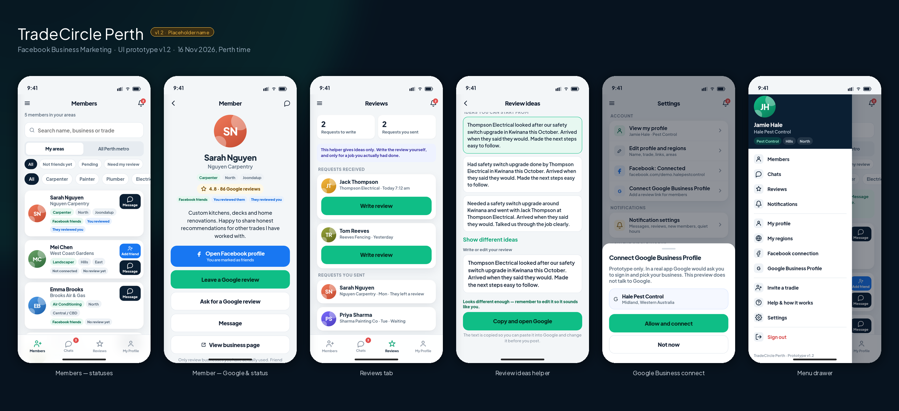
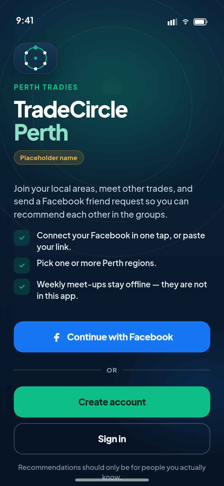
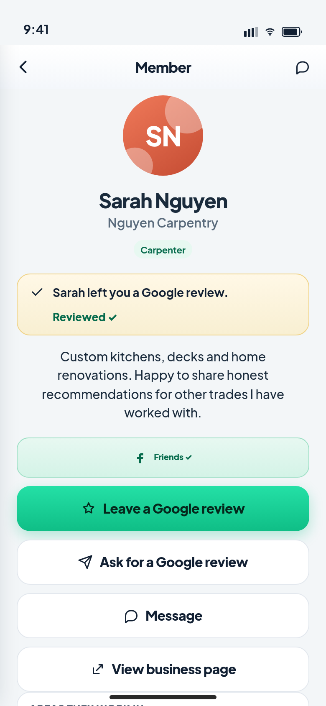
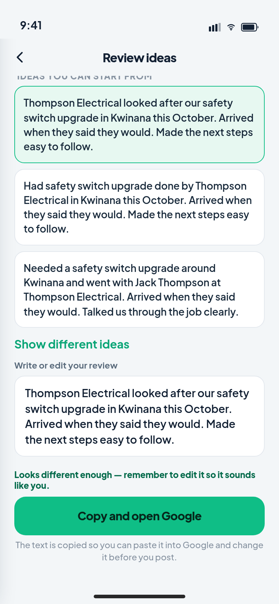
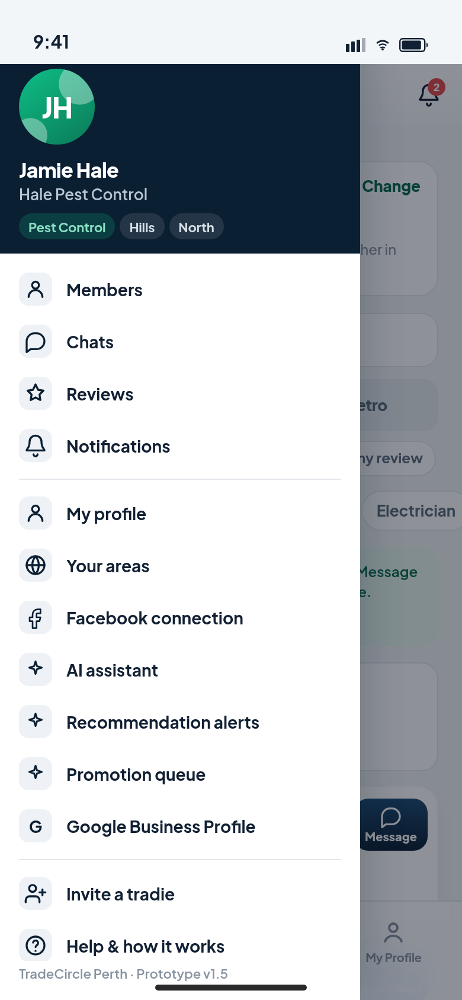
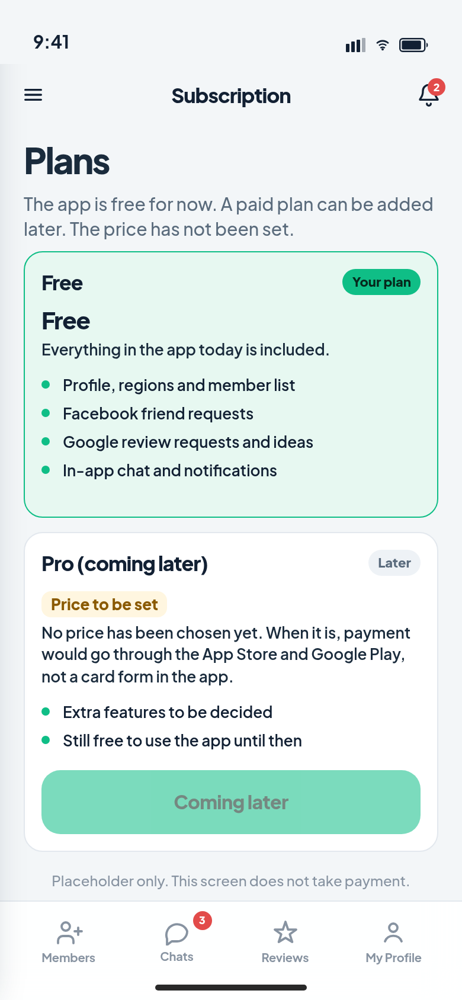
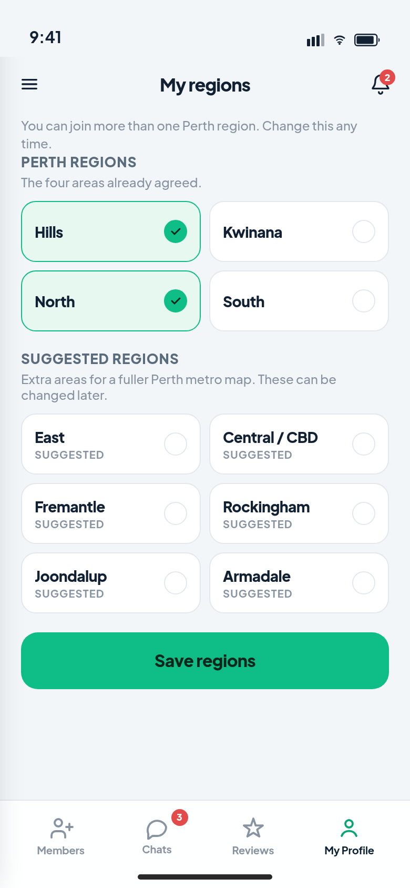
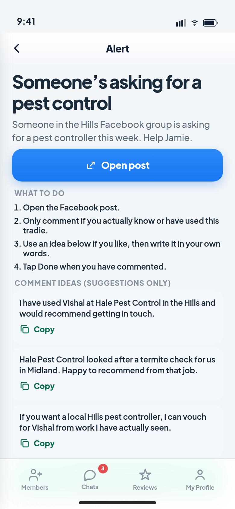
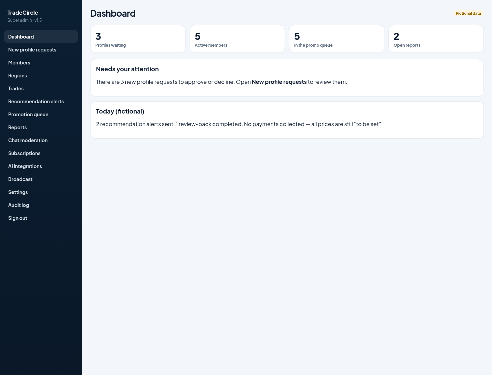
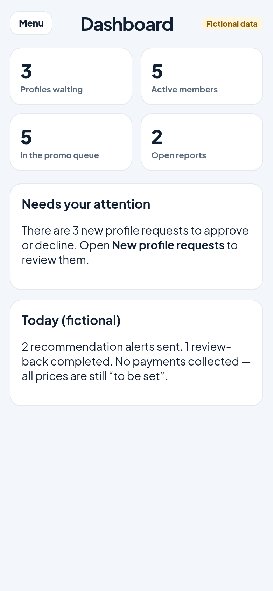

# TradeCircle Perth

**Placeholder app name — not final.**

A simple app for Perth tradies to find each other, become Facebook friends, and leave genuine Google reviews for jobs they have actually done.

**[Open the live preview](https://vishalchopra77-commits.github.io/tradecircle-perth-preview/)** — the front page. **[Open the full-screen app](https://vishalchopra77-commits.github.io/tradecircle-perth-preview/TradeCircle-Perth.html)** on a phone. New files (v1.6.2, built on unpushed v1.6.1) are ready in this repo; the live site updates after they are pushed. Do not push unless Vishal asks.

---

## What it is

Vishal Chopra is a pest controller in Perth, Western Australia. He wants a referral circle of local tradespeople (pest control, carpenter, painter, plumber and other trades).

Members meet in person every week — those meet-ups stay **offline**, not in the app — and are friends on Facebook. When someone asks in a Facebook group for a recommendation, circle members who actually know that person can vouch for them and tag their business page.

This repository is a **clickable HTML/CSS/JavaScript UI prototype**, not a real shipped app. Facebook and Google consent screens are mocks. Chat and review drafts stay on the device. **All member names, businesses, ratings, chats and photos are fictional.**

The online GitHub copy is the source of truth: [github.com/vishalchopra77-commits/tradecircle-perth-preview](https://github.com/vishalchopra77-commits/tradecircle-perth-preview). [Google Drive](https://drive.google.com/drive/folders/14jfv6IgaBUlpMkdCxcK1f4gNQhL59qpX) is the backup. The Mac folder is updated later, when a version is finished.

---

## Features

- Profiles with a trade and **more than one Perth region** (Hills, Kwinana, North, South and others)
- **Your areas** shown together in one list, plus **Join all Perth metro** to select every region at once (turning it off returns to your own picks)
- Member list with **My areas** or **All Perth metro**, plus trade search with autocomplete
- **Sign up** with Facebook, email or phone, then name, then business and regions, then send for approval; after approval, fill or skip a simple Complete your profile step
- **Add friend** on every member card
- Facebook friend status and Google review status, with filters such as “Not friends yet” and “Need my review”
- **Google Business Profile** connection (mocked in this prototype)
- One-tap **review requests**
- **Review ideas helper** — suggestions only, not finished or pre-written reviews, with a Copy button and unique ideas per member
- **Daily Google review cap** of 3 per business per Perth day, with a clear lock banner when the limit is reached
- Profile **website and social links** (Facebook page, Instagram, LinkedIn, TikTok, YouTube, Google Business, Other)
- Full in-app **chat** (one-to-one and a group per region) with modern chat features and push notification mocks
- Top-left **hamburger menu** plus bottom tabs
- **Subscription** screen: Free (current, everything included now) and Pro (coming later) with a **Price to be set** label
- **AI assistant** (mock) with voice commands that open pages for the member to tap
- Chat attachments (photo, file, camera) and emoji
- **Recommendation alerts** and a free **promotion queue** (paid jump later, price to be set)
- **Super admin** web dashboard, including approval of new members

---

## What’s new in v1.6.2

After you pick a state, metro and regional areas open as drop-down sections on the same screen (Metro is open first). A short tip explains that Google local search favours reviews from nearby customers, so it is better not to tick areas outside your working zone. A gentle nudge appears if you select a lot of areas.

## What’s new in v1.6.1

The area picker is now Australia-wide. Members choose a state or territory first, then Metro or Regional, then the regions they work in. The ten existing Perth metro regions are unchanged. Sign-up, My areas, Edit profile and the admin regions list all use this flow. Suburbs are not shown in the app.

## What’s new in v1.6.0

The sign-up and profile picker is now **Trade or business type**, not trades only. Suggestions appear as you type from a researched list of **456** Australian trades and local businesses (hairdressers, barbers, cafes, shops, clinics, mechanics and the rest), including every existing trade. Aliases such as “hair salon” or “coffee shop” are included in autofill. **See all** opens a grouped list. New types get a small icon and a trade-style cover photo. A fictional Fremantle barber, Noah Barrett of Barrett Barbers, is in the demo circle.

## What’s new in v1.5.9

Profiles now have a **full-width trade cover photo** behind the avatar (pest control, carpenter, electrician, plumber, air conditioning, landscaper and other trades, plus a generic tradie fallback), so you can tell the business at a glance. A **small trade icon** sits after every trade label — on member cards, review-back cards, profiles, filter chips and the sign-up trade picker. **Your areas / Change** moved from the Facebook Circle screen onto **My profile**. The Facebook tab now has three segments: **Circle**, **Recommend** and **Queue**. Recommend lists Facebook group post links shared by admin; members open the post, copy a unique recommendation idea, and mark it as done when they have vouched. A post for your own business shows **This one is for you** instead of vouch actions. Super admin has a **Facebook recommendations** page to paste a group link, choose the member, and track completion. Cover photo credits are in [`TRADE-COVER-CREDITS.md`](TRADE-COVER-CREDITS.md).

## What’s new in v1.5.8

Sign-up stays basic: **Continue with Facebook, email or phone**, then **first and last name**, then **business details and Perth regions**, then **Send for approval**. Extra profile writing is no longer part of sign-up. After a super admin approves, the first screen is **Complete your profile** (social links, a short sentence, short bio, goal, about my business, expertise, ideal referral partner), with **Skip for now** and **Save**. If it is skipped, a gentle **Finish your profile** card with a percentage shows on Home and My profile. A **Demo: new member sign-up** entry is in Settings (and More / the drawer if present), and the waiting screen has **Demo: simulate approval**. The Facebook queue wait is now one shared figure everywhere — place #4 is **about 6 days** on Home and on the queue screen.

## What’s new in v1.5.7

The Facebook (people) tab and the Queue tab are now **one Facebook tab**, with the Facebook **f** icon. At the top of that screen a clear switch lets members move between **Circle** (members and friends) and **Promotion queue**. The queue segment also shows **Your place #4**, so the queue stays easy to find. The bottom menu is now **Home, Reviews, Facebook, More**. Links that used to open the Queue tab (Home, More, the drawer, My profile, notifications) now open the Facebook tab on the Promotion queue segment.

## What’s new in v1.5.6

The separated Home sections stay, but the plain white stat boxes are gone. Each section now has colourful gradient tiles like the older Home dashboard: an icon chip, a large number, a label and a soft circle in the corner. Google reviews uses amber and navy tiles, Facebook uses Facebook blue and navy, Messages uses teal tiles for Unread and Chats, and Friends uses green tiles for Friends and Pending. Section headers have a soft tint in the same colour family.

## What’s new in v1.5.5

Home is easier on the eye. The mixed 2×2 gradient stat tiles are gone. In their place are four clearly separated overview cards, each with its own heading and icon: **Google reviews** (reviews received and given, today’s count against the daily cap, pending review-backs, and a button to Reviews), **Facebook** (queue place, next promotion turn, pending comments, and a button to the Queue), **Messages** (unread count, the latest conversation previews with truncated text, and a button to Chats), and a smaller **Friends** card (friends count and pending requests). Cards use soft tinted backgrounds and a thin accent strip rather than heavy saturated gradients. The greeting at the top is unchanged. Chat-list previews are also clipped with an ellipsis so long messages do not overflow.

## What’s new in v1.5.4

Review idea cards (and other suggested text) have a clear **Copy** button. Tapping it copies the text and shows “Copied, now paste it in Google”. Ideas are unique per member and per business: a line that has already been copied or used is not shown to someone else. “Show different ideas” also skips used lines. A large combinatorial engine (openings, trade-specific jobs, Perth suburbs, praise, closings, tone, length and focus chips) keeps variety high. Focus defaults are Medium, Casual, and Search-friendly + Service + Area. See [REVIEW-IDEAS-RESEARCH.md](REVIEW-IDEAS-RESEARCH.md).

A member or business can receive at most **3 Google reviews per day** from the circle (Perth midnight reset). At 3 of 3, a lock banner says the daily limit is reached and opens tomorrow, and Review / Review back is locked. The cap is configurable in super admin Settings.

Profiles have a **Links** section (website, Facebook page, Instagram, LinkedIn, TikTok, YouTube, Google Business, optional Other), plus optional **About my business** (bio, years in business, service areas), **Expertise** (specialty chips and licences), an **image gallery** with a full-screen swipe viewer (mock add/remove on My profile), **My ideal referral partner**, and **My goals** with progress. These fields are optional in sign-up and edit, and also show in the admin member detail view.

Icons: Reviews use the Google **G** everywhere a Google review is meant; the Queue uses the Facebook **f** (the Facebook members tab keeps the people icon). Notifications, the Home activity feed, notification settings and the admin activity feed each use a type-specific tinted icon (G for reviews, f for the queue, people for friend requests, person-plus for new members, chat bubble for mentions, megaphone for recommendation alerts, shield for approvals, lock for the daily limit).

## What’s new in v1.5.3

The bottom menu is now **Home, Reviews, Facebook, Queue, More**. Chat has moved into the top bar, next to the bell, with an unread badge. Home is a member dashboard: a greeting, stat tiles, a “Needs your attention” list, quick actions and a recent activity feed. After sign-in, or when previewing the app from the approval screen, you land on Home.

## What’s new in v1.5.2

The Facebook promotion queue is now easy to find: it has its own **Queue** tab on the bottom menu (Facebook f icon in v1.5.4), a “Your turn to promote” card at the top of the Facebook/members home, and a row on My profile. The bottom menu is now Reviews, Facebook, Chat, Queue and More. More opens a full menu with a search box and a grid of round shortcut tiles, grouped in sections. The active tab uses a TradeCircle green pill, not a copied colour scheme. The slide-out menu is still there from the header, with a proper queue icon.

## What’s new in v1.5.1

The super admin dashboard is now a proper control panel rather than a plain list of pages. Every sidebar item and button has an icon. The home screen has gradient KPI cards with trends, a weekly chart for members and alerts (fictional), a recent profile-request table with avatar and Approve/Decline buttons, a recent activity feed, a promotion-queue preview, and a header with search, notifications and the admin avatar. Every admin page uses the same polish (avatars, status pills, icon buttons, empty states). On a phone there is a bottom navigation bar plus a slide-out menu.

In the member app, recommendation alert headlines now read naturally, for example “Someone’s asking for a pest controller”, and remaining primary buttons have icons.

## What’s new in v1.5

Released 16 November 2026, Australia/Perth.

- Separate **First name** and **Last name** on sign-up, profile creation and edit
- New members **wait for admin approval** (Awaiting approval screen)
- **AI assistant** (prototype/mock): connect Grok, ChatGPT, Claude or other; voice commands for updates, reminders and navigation. Friend requests and Google reviews are never sent automatically — the assistant opens the page, and the member taps the button
- Chat **attach** (camera, photo, file) plus an **emoji** picker, with sample photo and file messages
- **241 Australian trades** in the picker and search, sourced from hipages, Oneflare, Airtasker, ServiceSeeking and Yellow Pages style directories — see [TRADES-SOURCES.md](TRADES-SOURCES.md)
- **Super admin** dashboard (`admin.html`, or the standalone `TradeCircle-Admin.html`): approve members, manage regions, trades, alerts, the promotion queue, reports, chats, plans, AI settings, broadcasts and an audit log. Demo login, mobile-friendly
- Facebook-style friend buttons: **Add friend** / **Request sent** / **Friends ✓**
- Instagram-style **Review back** when someone left you a Google review, plus **Reviewed ✓**. Review helper stays **ideas only**
- **Recommendation alerts**: paste a Facebook post, pick the trade, send to the circle; alert card with Open post, comment ideas and Copy, and “Done, I commented”
- **Promotion queue**: free turns, paid “Jump the queue” later with **Price to be set** (no payment in this prototype)
- Visual polish: button icons and tasteful gradients

### What’s new in v1.4

Released 16 November 2026, Australia/Perth.

- **Your areas** are shown together in one combined list (chips on one card), not split into separate “agreed” and “suggested” sections
- **Join all Perth metro** on the region picker (profile setup, Your areas, and Edit profile). Turning it off returns to the previous manual picks
- The Members **My areas** list still combines people from all of your areas in one list, with a Your areas summary card. **All Perth metro** still shows everyone
- Member cards no longer show each person’s regions. Crowded status wording is replaced with small Facebook and review icons, plus a short icon guide on the Members list
- New stills: `screens/33-create-regions-all-metro.png`, `screens/34-my-regions-all-metro.png`, `screens/35-edit-areas.png`, `screens/36-member-areas.png`, before/after member cards `screens/37-members-cards-before.png` and `screens/07-members-my-areas.png`

### What’s new in v1.3

Released 16 November 2026, Australia/Perth.

- **Subscription** screen (Free now, Pro later) with a clearly labelled **Price to be set** — no invented prices
- A drawer menu item for Subscription
- **[TECH-PLAN.md](TECH-PLAN.md)** — how one app will work on iPhone and Android, AWS in Sydney, security, store rules, and a later subscription

### What’s new in v1.2

Released 16 November 2026, Australia/Perth.

- Hamburger menu and slide-out drawer
- Google Business Profile connection
- Friend and review status on every member
- Reviews tab and one-tap review requests
- Review ideas helper (the member writes the final review)
- Full in-app chat and notification mocks

See the earlier [README notes](archive/v1.1/README.md) and [v1 notes](archive/v1/README.md) for what was already in v1.1 and v1. Detailed policy notes on Facebook Login and reviews also remain in those files and in [START-HERE.md](START-HERE.md).

---

## Screenshots

Chat, notifications and the lock-screen mock:

| Screen | Preview |
| --- | --- |
| Welcome |  |
| Sign up with Facebook |  |
| Members — My areas |  |
| Member profile |  |
| Reviews |  |
| Review ideas helper |  |
| Chats |  |
| Menu drawer |  |
| Subscription |  |
| Your areas |  |
| Join all Perth metro |  |
| Recommendation alert |  |
| Super admin dashboard (desktop) |  |
| Super admin dashboard (phone) |  |

More stills are in [`screens/`](screens/), including the polished v1.5.1 admin pages.

---

## Version history

| Version | When (Australia/Perth) | What it added |
| --- | --- | --- |
| v1 | 16 Nov 2026, about 7:39–7:56 am | First 13 screens: sign-up, profile, regions, member list, settings |
| v1.1 | 16 Nov 2026, about 8:06–8:15 am | Facebook sign-up and connect, Add friend, trade autocomplete, paste-link backup |
| v1.2 | 16 Nov 2026, about 8:26–8:28 am | Menu drawer, Google Business Profile, friend and review status, Reviews tab, review ideas helper, full chat, notification mocks |
| v1.3 | 16 Nov 2026, about 9:47 am | Subscription screen (Free now, Pro later, **Price to be set**), [TECH-PLAN.md](TECH-PLAN.md) for the real cross-platform app on AWS in Sydney |
| v1.4 | 16 Nov 2026, about 10:02 am | Your areas in one combined list; **Join all Perth metro**; cleaner member cards (no region labels; Facebook and review status as icons) |
| **v1.6.2 (current)** | 19 Nov 2026, about 7:50 am | Area picker: after the state, Metro and Regional are accordions on one screen (Metro open first). Tip about nearby Google reviews and working zones. |
| **v1.6.1** | 19 Nov 2026, about 7:30 am | Australia-wide area picker: state, then metro or regional, then multi-select regions. Perth’s ten metro regions stay exactly as they were. Summary of chosen areas on sign-up and My profile. |
| **v1.6.0** | 19 Nov 2026, about 6:20 am | Trade or business type picker for all physical / local businesses as well as trades; 456 types in 16 groups, with aliases in autofill and a grouped See all list; icons and cover fallbacks for new types; fictional barber added to the demo. |
| **v1.5.9** | 18 Nov 2026, about 7:10 am | Trade cover photos on profiles; a small trade icon after every trade label; Your areas moved to My profile; Facebook Recommend segment for admin-posted group links (open, copy a unique vouch idea, mark as done; “This one is for you” on your own post); admin Facebook recommendations page. |
| **v1.5.8** | 18 Nov 2026, about 6:45 am | Basic multi-step sign-up (Facebook, email or phone, then name, then business and regions) and send for approval. After approval, a fill-or-skip Complete your profile step, with a Finish your profile card if skipped. Shared queue wait days (place #4 is about 6 days). |
| **v1.5.7** | 17 Nov 2026, about 8:45 pm | Facebook and Queue tabs combined into one Facebook tab (f icon) with a Circle / Promotion queue switch; four-tab bottom bar (Home, Reviews, Facebook, More). |
| **v1.5.6** | 17 Nov 2026, about 8:40 pm | Colourful gradient stat tiles restored inside the separated Home sections, with tinted section headers. |
| **v1.5.5** | 17 Nov 2026, about 8:35 pm | Home dashboard split into separate Google reviews, Facebook, Messages and Friends overview cards (soft tints, no mixed gradient tiles); chats-list preview overflow tightened. |
| **v1.5.4** | 17 Nov 2026, about 3:15 am | Copy buttons on review ideas and other suggested text; unique idea engine and focus chips; daily Google review cap (3 per business, Perth midnight); profile links; Google G / Facebook f icons; typed notification icons. |
| **v1.5.3** | 17 Nov 2026, about 2:25 am | Home dashboard as the first tab. Chat icon in the header next to notifications. Bottom menu: Home, Reviews, Facebook, Queue, More. Sign-in lands on Home. |
| **v1.5.2** | 17 Nov 2026, about 2:15 am | Facebook promotion queue on the bottom menu, home card and profile. Five-tab bar (Reviews, Facebook, Chat, Queue, More). More menu is an apps grid with search. Brand-coloured active-tab pill. |
| **v1.5.1** | 16 Nov 2026, about 10:50 am | Polished super admin (icons, gradient KPIs, charts, dashboard requests, activity, queue preview, header with search and notifications). Mobile bottom nav. Alert headline grammar and button icons in the app. |
| **v1.5** | 16 Nov 2026, about 10:40 am | First/last name; awaiting approval; AI assistant (mock); chat attachments and emoji; 241 trades; admin dashboard; Facebook-style friend buttons; Review back; recommendation alerts; promotion queue |

Older versions are in [`archive/v1/`](archive/v1/) and [`archive/v1.1/`](archive/v1.1/). Do not delete them — archive first, then add a new version.

---

## How to open the prototype

1. **Online (once Pages is live):** [vishalchopra77-commits.github.io/tradecircle-perth-preview](https://vishalchopra77-commits.github.io/tradecircle-perth-preview/)
2. **On a computer:** open `index.html` in a browser. You get a studio view with the phone in the middle and a screen list on the right. Use **Open the app** on the left, or click a screen name.
3. **On a phone:** the same `index.html` opens the app full screen.
4. `TradeCircle-Perth.html` is the same prototype with CSS and JavaScript inlined. Keep the `fonts/` folder beside either file.

Deep links: `index.html#members`, `index.html#chats`, `index.html#reviews`, `index.html?shot=welcome`.

---

## How to work on it

Read **[AI-INSTRUCTIONS.md](AI-INSTRUCTIONS.md)** before you change anything, **[START-HERE.md](START-HERE.md)** for the full product story and open questions, and **[TECH-PLAN.md](TECH-PLAN.md)** for how the real iPhone and Android app would be built (one app, AWS in Sydney, free now, subscription later).

In short:

- Work on this GitHub copy (and keep the Drive backup in sync). Do not treat the Mac folder as the source of truth.
- Fictional data only. No secrets.
- Never delete files. Archive the previous version first, then bump the number (next is v1.6).
- Ask Vishal one question at a time, in plain words, when a decision is needed.
- Keep weekly meet-ups offline. Keep the Facebook paste-link backup. Keep the review helper as **ideas only**.

Open questions still waiting on Vishal:

Further decisions (16 November 2026): Vishal already has Apple App Store and Google Play developer accounts. The real app will be **one app for iPhone and Android**, hosted on **AWS in Sydney**. It stays **free for now**; a subscription can come later, with prices still to be set.

Open questions still waiting on Vishal:

1. What is the real app name?
2. When he is ready: what should a paid plan include, and what is the price?
3. When he is ready: what should “Jump the queue” cost? (Until then, use **Price to be set**.)

New members wait for Vishal’s approval (decided in v1.5).

---

## Reviews must stay as ideas only

The helper may suggest different sentence starters after a member picks a real job they actually had done (service, suburb, month, what stood out). It must **not** generate finished, ready-made, swapped or duplicate reviews. The member writes or edits the final review in their own words.

Google can remove reviews and suspend a Business Profile for fake, incentivised or conflict-of-interest reviews. Australian Consumer Law, as explained by the ACCC, also makes fake or misleading reviews illegal. See [START-HERE.md](START-HERE.md) and the policy links in the v1.2 notes inside the prototype.

---

## All data is fictional

Every member, business, rating, chat, review and photo in this preview is made up. Nothing is sent to Facebook or Google.

---

*Prototype v1.6.2 · 19 November 2026, Australia/Perth*
