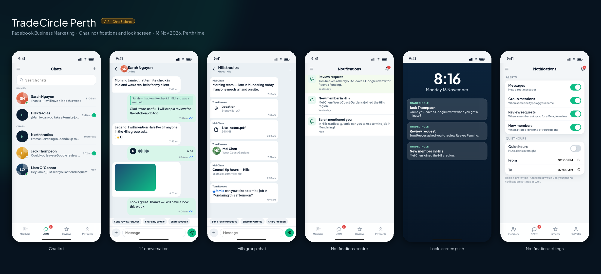
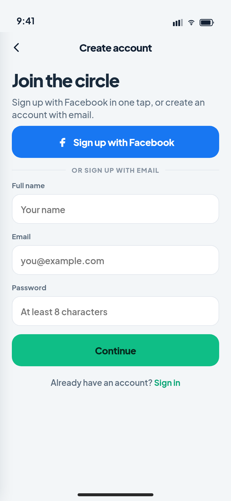
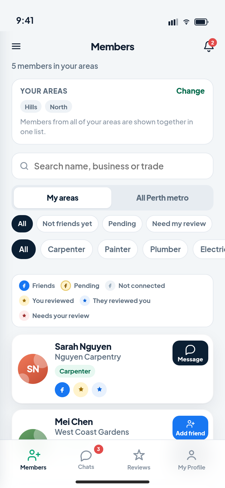
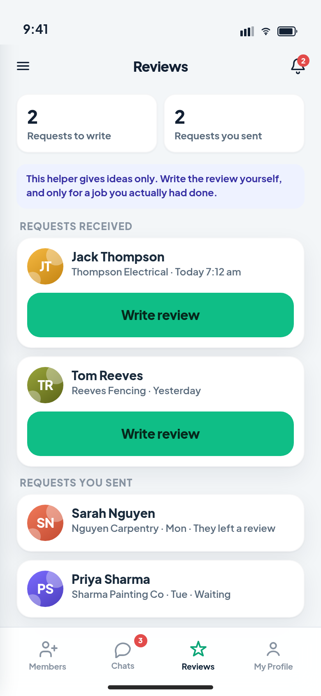
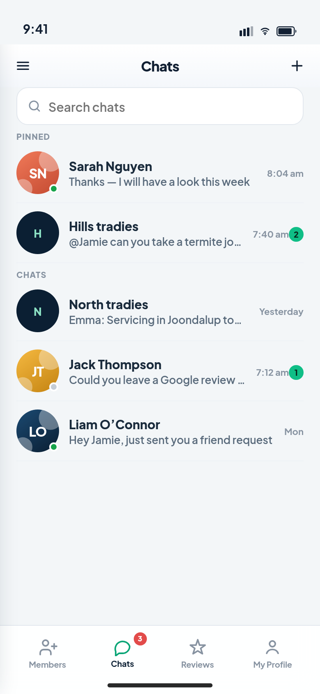
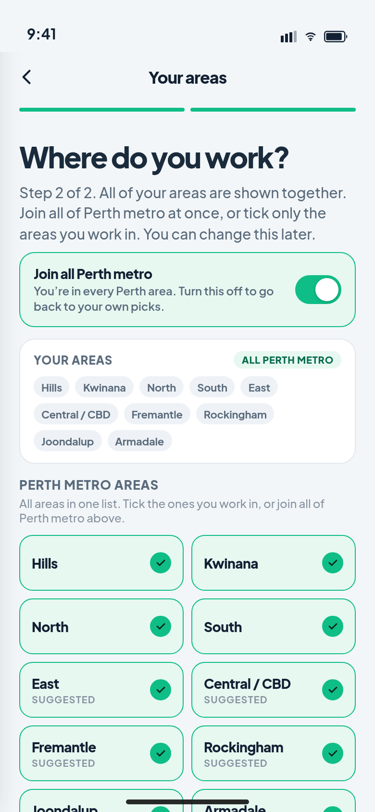

# TradeCircle Perth

**Placeholder app name — not final.**

A simple app for Perth tradies to find each other, become Facebook friends, and leave genuine Google reviews for jobs they have actually done.

**[Open the live preview](https://vishalchopra77-commits.github.io/tradecircle-perth-preview/)** — the front page. **[Open the full-screen app](https://vishalchopra77-commits.github.io/tradecircle-perth-preview/TradeCircle-Perth.html)** on a phone. New files (v1.4) are ready in this repo; the live site updates after they are pushed.

---

## What it is

Vishal Chopra is a pest controller in Perth, Western Australia. He wants a referral circle of local tradespeople (pest control, carpenter, painter, plumber and other trades).

Members meet in person every week — those meet-ups stay **offline**, not in the app — and are friends on Facebook. When someone asks in a Facebook group for a recommendation, circle members who actually know that person can vouch for them and tag their business page.

This repository is a **clickable HTML/CSS/JavaScript UI prototype**, not a real shipped app. Facebook and Google consent screens are mocks. Chat and review drafts stay on the device. **All member names, businesses, ratings, chats and photos are fictional.**

The online GitHub copy is the source of truth: [github.com/vishalchopra77-commits/tradecircle-perth-preview](https://github.com/vishalchopra77-commits/tradecircle-perth-preview). [Google Drive](https://drive.google.com/drive/folders/14jfv6IgaBUlpMkdCxcK1f4gNQhL59qpX) is the backup. The Mac folder is updated later, when a version is finished.

---

## Features

- Profiles with a trade and **more than one Perth region** (Hills, Kwinana, North, South and others)
- **Your areas** shown together in one list, plus **Join all Perth metro** to select every region at once (turning it off returns to your own picks)
- Member list with **My areas** or **All Perth metro**, plus trade search with autocomplete
- **Sign up with Facebook** / Continue with Facebook, and a **paste your Facebook link** backup
- **Add friend** on every member card
- Facebook friend status and Google review status, with filters such as “Not friends yet” and “Need my review”
- **Google Business Profile** connection (mocked in this prototype)
- One-tap **review requests**
- **Review ideas helper** — suggestions only, not finished or pre-written reviews
- Full in-app **chat** (one-to-one and a group per region) with modern chat features and push notification mocks
- Top-left **hamburger menu** plus bottom tabs
- **Subscription** screen: Free (current, everything included now) and Pro (coming later) with a **Price to be set** label

---

## What’s new in v1.4

Released 16 November 2026, Australia/Perth.

- **Your areas** are shown together in one combined list (chips on one card), not split into separate “agreed” and “suggested” sections
- **Join all Perth metro** on the region picker (profile setup, Your areas, and Edit profile). Turning it off returns to the previous manual picks
- The Members **My areas** list still combines people from all of your areas in one list, with a Your areas summary card. **All Perth metro** still shows everyone
- Member cards no longer show each person’s regions. Crowded status wording is replaced with small Facebook and review icons, plus a short icon guide on the Members list
- New stills: `screens/33-create-regions-all-metro.png`, `screens/34-my-regions-all-metro.png`, `screens/35-edit-areas.png`, `screens/36-member-areas.png`, before/after member cards `screens/37-members-cards-before.png` and `screens/07-members-my-areas.png`

### What’s new in v1.3

Released 16 November 2026, Australia/Perth.

- **Subscription** screen (Free now, Pro later) with a clearly labelled **Price to be set** — no invented prices
- A drawer menu item for Subscription
- **[TECH-PLAN.md](TECH-PLAN.md)** — how one app will work on iPhone and Android, AWS in Sydney, security, store rules, and a later subscription

### What’s new in v1.2

Released 16 November 2026, Australia/Perth.

- Hamburger menu and slide-out drawer
- Google Business Profile connection
- Friend and review status on every member
- Reviews tab and one-tap review requests
- Review ideas helper (the member writes the final review)
- Full in-app chat and notification mocks

See the earlier [README notes](archive/v1.1/README.md) and [v1 notes](archive/v1/README.md) for what was already in v1.1 and v1. Detailed policy notes on Facebook Login and reviews also remain in those files and in [START-HERE.md](START-HERE.md).

---

## Screenshots

Chat, notifications and the lock-screen mock:

| Screen | Preview |
| --- | --- |
| Welcome |  |
| Sign up with Facebook |  |
| Members — My areas |  |
| Member profile |  |
| Reviews |  |
| Review ideas helper |  |
| Chats |  |
| Menu drawer |  |
| Subscription |  |
| Your areas |  |
| Join all Perth metro |  |

More stills are in [`screens/`](screens/).

---

## Version history

| Version | When (Australia/Perth) | What it added |
| --- | --- | --- |
| v1 | 16 Nov 2026, about 7:39–7:56 am | First 13 screens: sign-up, profile, regions, member list, settings |
| v1.1 | 16 Nov 2026, about 8:06–8:15 am | Facebook sign-up and connect, Add friend, trade autocomplete, paste-link backup |
| v1.2 | 16 Nov 2026, about 8:26–8:28 am | Menu drawer, Google Business Profile, friend and review status, Reviews tab, review ideas helper, full chat, notification mocks |
| v1.3 | 16 Nov 2026, about 9:47 am | Subscription screen (Free now, Pro later, **Price to be set**), [TECH-PLAN.md](TECH-PLAN.md) for the real cross-platform app on AWS in Sydney |
| **v1.4 (current)** | 16 Nov 2026, about 10:02 am | Your areas in one combined list; **Join all Perth metro**; cleaner member cards (no region labels; Facebook and review status as icons) |

Older versions are in [`archive/v1/`](archive/v1/) and [`archive/v1.1/`](archive/v1.1/). Do not delete them — archive first, then add a new version.

---

## How to open the prototype

1. **Online (once Pages is live):** [vishalchopra77-commits.github.io/tradecircle-perth-preview](https://vishalchopra77-commits.github.io/tradecircle-perth-preview/)
2. **On a computer:** open `index.html` in a browser. You get a studio view with the phone in the middle and a screen list on the right. Use **Open the app** on the left, or click a screen name.
3. **On a phone:** the same `index.html` opens the app full screen.
4. `TradeCircle-Perth.html` is the same prototype with CSS and JavaScript inlined. Keep the `fonts/` folder beside either file.

Deep links: `index.html#members`, `index.html#chats`, `index.html#reviews`, `index.html?shot=welcome`.

---

## How to work on it

Read **[AI-INSTRUCTIONS.md](AI-INSTRUCTIONS.md)** before you change anything, **[START-HERE.md](START-HERE.md)** for the full product story and open questions, and **[TECH-PLAN.md](TECH-PLAN.md)** for how the real iPhone and Android app would be built (one app, AWS in Sydney, free now, subscription later).

In short:

- Work on this GitHub copy (and keep the Drive backup in sync). Do not treat the Mac folder as the source of truth.
- Fictional data only. No secrets.
- Never delete files. Archive the previous version first, then bump the number (next is v1.5).
- Ask Vishal one question at a time, in plain words, when a decision is needed.
- Keep weekly meet-ups offline. Keep the Facebook paste-link backup. Keep the review helper as **ideas only**.

Open questions still waiting on Vishal:

Further decisions (16 November 2026): Vishal already has Apple App Store and Google Play developer accounts. The real app will be **one app for iPhone and Android**, hosted on **AWS in Sydney**. It stays **free for now**; a subscription can come later, with prices still to be set.

Open questions still waiting on Vishal:

1. Should new tradies join straight away, or should he approve each new member first?
2. What is the real app name?
3. When he is ready: what should a paid plan include, and what is the price?

---

## Reviews must stay as ideas only

The helper may suggest different sentence starters after a member picks a real job they actually had done (service, suburb, month, what stood out). It must **not** generate finished, ready-made, swapped or duplicate reviews. The member writes or edits the final review in their own words.

Google can remove reviews and suspend a Business Profile for fake, incentivised or conflict-of-interest reviews. Australian Consumer Law, as explained by the ACCC, also makes fake or misleading reviews illegal. See [START-HERE.md](START-HERE.md) and the policy links in the v1.2 notes inside the prototype.

---

## All data is fictional

Every member, business, rating, chat, review and photo in this preview is made up. Nothing is sent to Facebook or Google.

---

*Prototype v1.4 · 16 November 2026, Australia/Perth*
